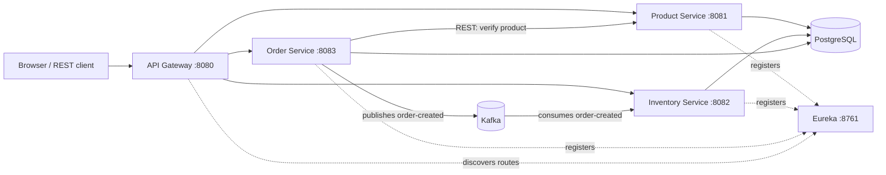

# E-commerce Microservices Capstone

A small, deliberately readable Java 17/Spring Boot project for learning the shape of a microservice system. It contains **three business microservices** (Product, Inventory, and Order), Eureka service discovery, Spring Cloud Gateway, PostgreSQL persistence, REST CRUD APIs, and one Kafka asynchronous workflow.

This is a teaching capstone, not a production checkout system. Its purpose is to help you see where each responsibility lives before adding authentication, payments, observability, retries, and distributed-transaction patterns.

## What you will build

| Component | Port | Responsibility |
| --- | ---: | --- |
| Discovery Server | 8761 | Eureka registry: services announce themselves here |
| API Gateway | 8080 | One entry point; routes requests by service name |
| Product Service | 8081 | Product catalog CRUD |
| Inventory Service | 8082 | Stock CRUD and async stock reservation |
| Order Service | 8083 | Order CRUD, product validation, and Kafka event publishing |
| Local PostgreSQL | 5432 | Relational data store; each service owns its own tables |
| Local Kafka | 9092 | Event broker for `order-created` |

## Architecture diagram



## Request flow, explained

1. A client calls the gateway, for example `POST /api/orders` at port 8080.
2. Gateway asks Eureka where `order-service` is and forwards the request.
3. Order Service makes a synchronous REST call to Product Service to verify that the product exists. This is a simple example of request/response service communication.
4. Order Service saves the order with `PENDING` status in PostgreSQL.
5. It publishes `OrderCreatedEvent(orderId, productId, quantity)` to Kafka's `order-created` topic and immediately returns `201 Created`.
6. Inventory Service receives the event later and decreases its matching stock quantity. This is asynchronous: Order Service does not wait for Inventory Service to finish.

The async flow is deliberately eventually consistent. In a production system, add a reservation result event, idempotency, a transactional outbox, retry/DLT policies, and a failure status for insufficient stock.

## Run it locally

### Prerequisites

- JDK 17 (`java -version`)
- Maven 3.9+ (`mvn -version`)
- PostgreSQL 16+ running locally on port `5432`
- Apache Kafka running locally on port `9092`

### 1. Configure local PostgreSQL

Create the database and application user in your local PostgreSQL installation:

```sql
CREATE USER ecommerce WITH PASSWORD 'ecommerce';
CREATE DATABASE ecommerce OWNER ecommerce;
```

The services use this local connection by default:

```text
jdbc:postgresql://localhost:5432/ecommerce
username: ecommerce
password: ecommerce
```

### 2. Start Kafka locally

Start a local Kafka broker configured to listen on `localhost:9092`. The project automatically creates the `order-created` topic when Order Service first publishes to it (Kafka's default topic auto-creation must be enabled).

If topic auto-creation is disabled in your Kafka installation, create it once:

```bash
kafka-topics.sh --bootstrap-server localhost:9092 --create \
  --topic order-created --partitions 1 --replication-factor 1
```

### 3. Start the Spring applications

Run each command in a separate terminal, in this order:

```bash
mvn -pl discovery-server spring-boot:run
mvn -pl product-service spring-boot:run
mvn -pl inventory-service spring-boot:run
mvn -pl order-service spring-boot:run
mvn -pl api-gateway spring-boot:run
```

Open `http://localhost:8761` to see registered services. Use the gateway at `http://localhost:8080`; do not normally call the individual services directly.

To compile every module without starting it:

```bash
mvn verify
```

Stop PostgreSQL and Kafka using the service manager or startup method used on your machine.

## API documentation

All public calls go through `http://localhost:8080`.

### Product Service

| Method | Endpoint | Purpose |
| --- | --- | --- |
| GET | `/api/products` | List products |
| GET | `/api/products/{id}` | Get a product |
| POST | `/api/products` | Create a product |
| PUT | `/api/products/{id}` | Replace product fields |
| DELETE | `/api/products/{id}` | Delete a product |

```bash
curl -X POST http://localhost:8080/api/products \
  -H 'Content-Type: application/json' \
  -d '{"name":"Mechanical Keyboard","price":89.99,"description":"Hot-swappable switches"}'
```

### Inventory Service

| Method | Endpoint | Purpose |
| --- | --- | --- |
| GET | `/api/inventory` | List stock records |
| GET | `/api/inventory/{productId}` | Get stock for a product |
| POST | `/api/inventory` | Create stock record |
| PUT | `/api/inventory/{productId}` | Set available quantity |
| DELETE | `/api/inventory/{productId}` | Delete stock record |

```bash
curl -X POST http://localhost:8080/api/inventory \
  -H 'Content-Type: application/json' \
  -d '{"productId":1,"availableQuantity":20}'
```

### Order Service

| Method | Endpoint | Purpose |
| --- | --- | --- |
| GET | `/api/orders` | List orders |
| GET | `/api/orders/{id}` | Get an order |
| POST | `/api/orders` | Create order and publish Kafka event |
| PUT | `/api/orders/{id}` | Update order fields |
| DELETE | `/api/orders/{id}` | Delete an order |

```bash
curl -X POST http://localhost:8080/api/orders \
  -H 'Content-Type: application/json' \
  -d '{"productId":1,"quantity":2}'

# After a short delay, verify that stock is now 18.
curl http://localhost:8080/api/inventory/1
```

## Configuration guide

Each application's `src/main/resources/application.yml` holds its port, service name, Eureka URL, and data/broker connection settings. Environment-specific values can override YAML without code changes:

```bash
SPRING_DATASOURCE_URL=jdbc:postgresql://db-host:5432/ecommerce \
SPRING_KAFKA_BOOTSTRAP_SERVERS=kafka-host:9092 \
mvn -pl order-service spring-boot:run
```

For real deployments, use one database/schema per service, set `ddl-auto` to `validate`, move secrets to a secret manager, and configure Kafka authentication/TLS.

## Code conventions used here

- Controllers only map HTTP requests; services contain application logic; repositories own persistence access.
- Request DTOs are Java records and validated with Jakarta Validation.
- Entities are not constructed from HTTP directly, and invalid/missing resources return suitable HTTP errors.
- Services communicate by a stable REST route or a small event payload, never by sharing database tables.

## Suggested beginner extensions

1. Add `RESERVED` and `REJECTED` order states plus an inventory-result topic.
2. Add OpenAPI/Swagger documentation and integration tests using Testcontainers.
3. Introduce Spring Security at the gateway.
4. Replace direct event publishing with the transactional outbox pattern.
